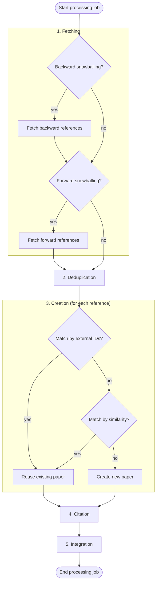

The
[Fetcher Orchestrator](https://github.com/SE-UUlm/snowballr-backend/blob/develop/src/main/kotlin/se/uulm/snowballr/backend/fetcher/FetcherOrchestrator.kt)
is one of the core pieces of this application. It holds a job queue that it sequentially processes. Other parts of the
application can enqueue jobs containing the project paper for which the snowballing method should be applied.

When a job is enqueued, the project settings are loaded. If no fetchers are configured for the project, the job is
discarded and only a warning is logged. Otherwise, the origin paper must exist, and the job is queued with the stage
after the origin paper's stage as its target stage.

> [!WARNING]
> The queue is held in memory only. Jobs that are queued or currently processed are lost when the backend restarts.

The orchestration process consists of the following steps:

## Fetching & Deduplication

Depending on the snowballing type in the project settings, the orchestrator retrieves the forward references, the
backward references, or both from all configured fetchers, e.g. Semantic Scholar. The `PythonPluginFetcherManager`
invokes the fetcher plugins, which call the APIs of the external databases.

The fetching results may contain duplicates, so the forward and backward sets are deduplicated separately. The
`PaperMatcher` merges papers whose similarity exceeds the similarity threshold configured in the project settings.

## Creation

Each deduplicated paper is stored in the database unless it already exists there. Existence is determined in two steps:

1. **External IDs:** A paper with at least one matching external ID is an exact match. This lookup is fast and checked
   first.
2. **Similarity:** Otherwise, all papers published in the same year (within a configured tolerance) serve as
   candidates. The `PaperMatcher` compares them to the fetched paper using the project's similarity threshold. The
   candidates are cached per year for the duration of a job.

If one of these steps finds an existing paper, the fetcher metadata of the fetched paper is merged into it, with
existing values taking precedence. All other paper data stays unchanged. If no existing paper is found, a new one is
created.

## Citation & Integration

Each stored paper is linked to the origin paper by a forward or backward citation. The papers are then added to the
project in the stage following the origin paper's stage. Both steps are idempotent: an existing citation or project
paper is left as is. This case is common, since fetched papers may already be in the project or linked to the origin
paper.

## Error handling

Errors are handled per step, so a single failure does not abort the whole job:

- If a fetcher call fails, e.g. because of a timeout or invalid output, it is retried up to 3 times with an
  exponentially growing delay (1s, 2s, 4s). If all attempts fail, the error is logged and the results of the remaining
  fetchers are still used. Since jobs are processed sequentially, a permanently failing fetcher delays the following
  jobs.
- If a fetcher cannot be invoked at all, e.g. because it does not exist, it is not retried and the job is aborted.
- If a database error occurs, it is logged and only the affected operation is skipped. A paper that cannot be created
  is left out of the remaining steps. If merging metadata, creating a citation, or adding a paper to the project fails,
  the paper is still processed in the other steps.
- Any other exception aborts the current job. It is logged, and the orchestrator continues with the next job in the
  queue.
